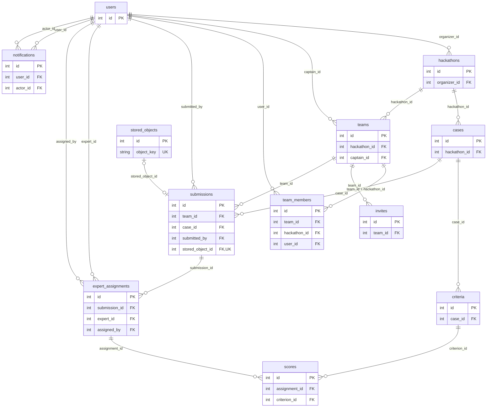
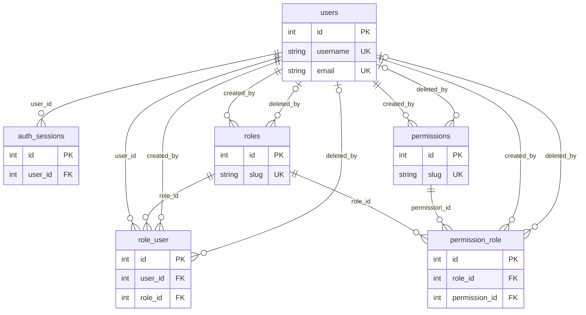

# PostgreSQL: схема, запуск и проверка

Проект использует **PostgreSQL 17 в Docker Compose**, SQLAlchemy 2.x,
драйвер psycopg 3 и Alembic. Основой служит уже существующая схема бэкенда
из `dev`: она содержит 17 прикладных таблиц, 32 внешних ключа и 7 CHECK-ограничений.
Таблица `alembic_version` хранит текущую ревизию и не входит в эти 17 таблиц.

SQL выбран из-за связанных сущностей и необходимости атомарных транзакций:
команды принадлежат хакатонам, решения - командам и кейсам, оценки - назначениям
экспертов. PostgreSQL контролирует внешние ключи и ограничения, SQLAlchemy
предоставляет ORM и управление транзакциями, psycopg соединяет Python с PostgreSQL,
Alembic последовательно обновляет схему и начальные роли.

## Файлы базы данных

```text
hackhaton/
|-- app/
|   |-- config.py                # POSTGRES_* из окружения; URL psycopg
|   |-- db.py                    # engine, pool_pre_ping, UTC, сессии
|   |-- models.py                # 17 ORM-моделей и ограничения
|   |-- dependencies.py          # выдача сессии обработчику запроса
|   |-- *_service.py             # запросы ORM и предметные транзакции
|   `-- health_routes.py         # SELECT 1, HTTP 200/503
|-- alembic/
|   |-- env.py                   # подключение и Base.metadata
|   `-- versions/                # 9 последовательных миграций
|-- scripts/
|   |-- init_env.py              # случайные локальные секреты
|   |-- verify_database.py       # схема, роли, commit/read/rollback
|   `-- database_snapshot.py     # счетчики и безопасные примеры строк
|-- tests/test_database.py       # 10 проверок реального PostgreSQL
|-- .github/workflows/database.yml # полный Compose-прогон в CI
|-- docker-compose.yml           # PostgreSQL 17, миграции, API, MinIO
|-- compose.database.yml         # необязательный локальный порт БД
`-- compose.test.yml             # отдельный тестовый Compose-проект
```

Поток данных: HTTP → маршрут FastAPI → сервис → Session SQLAlchemy → psycopg →
PostgreSQL. Сервисы выполняют `commit`/`rollback`; зависимость закрывает сессию
после запроса. `pool_pre_ping` проверяет соединения перед использованием,
тайм-аут соединения равен 5 секундам. Прикладные соединения используют UTC.
Архивы решений хранятся в MinIO, в SQL находятся метаданные и ссылка на объект.

## Миграции

| Ревизия | Назначение |
| --- | --- |
| `20260409_0000` | Пользователи и сессии авторизации |
| `20260409_0001` | Роли, разрешения, связующие таблицы |
| `20260409_0002` | Начальные роли и разрешения |
| `20260927_0003` | Профиль и роли платформы |
| `20260927_0004` | Хакатоны, кейсы, критерии |
| `20260927_0005` | Команды, состав, приглашения |
| `20260928_0006` | Решения и метаданные объектов |
| `20260928_0007` | Назначения экспертов и оценки |
| `20260928_0008` | Уведомления |

Эти миграции уже входят в бэкенд. Они повторно используются без создания второй,
несовместимой схемы. Схему изменяют только через Alembic; `create_all()` при
запуске приложения не вызывается. Повторный `upgrade head` не пересоздает таблицы.

## Таблицы и связи

| Таблица | Данные и основные связи |
| --- | --- |
| `users` | Учетные записи, bcrypt-хэши, профиль; логин и email уникальны без учета регистра |
| `auth_sessions` | Сессии пользователя, хэш refresh-токена, сроки и отзыв; FK → users |
| `roles` | Роли; created_by/deleted_by → users |
| `permissions` | Разрешения; created_by/deleted_by → users |
| `role_user` | Связь users M:N roles; автор назначения/удаления → users |
| `permission_role` | Связь roles M:N permissions; автор назначения/удаления → users |
| `hackathons` | События и сроки; organizer_id → users |
| `cases` | Задачи; hackathon_id → hackathons |
| `criteria` | Шкалы, веса и порядок критериев; case_id → cases |
| `teams` | Команды; hackathon_id → hackathons, captain_id → users |
| `team_members` | Состав; составной FK (team_id, hackathon_id) → teams; user_id → users |
| `invites` | Хэши кодов приглашений; team_id → teams |
| `stored_objects` | Ключ, имя, размер и SHA-256 архива в MinIO |
| `submissions` | Версии решений; team_id → teams, case_id → cases, submitted_by → users; необязательный stored_object_id → stored_objects |
| `expert_assignments` | Назначения; submission_id → submissions, expert_id/assigned_by → users |
| `scores` | Баллы; assignment_id → expert_assignments, criterion_id → criteria |
| `notifications` | Журнал; user_id/actor_id → users; resource_type/resource_id - логическая ссылка на объект события |

### ER-диаграмма предметной области

В блоках приведены ключевые поля. Дополнительные FK на `users` для организатора,
капитана, автора решения и назначения указаны в таблице выше.



### ER-диаграмма доступа



`1 → 0..N` означает, что у родителя может не быть дочерних строк. Один архив
привязан максимум к одному решению; решение может быть только ссылкой, без архива.
`notifications.resource_id` не является FK: это полиморфная ссылка журнала.

## Целостность и индексы

- `deadline_at > starts_at`; диапазоны оценок и положительные веса критериев.
- Уникальность `lower(username)` и `lower(email)`, а также названия команды внутри
  хакатона без учета регистра.
- Один пользователь входит максимум в одну команду каждого хакатона. Составной
  FK не допускает указания чужого хакатона в членстве команды.
- Частичный уникальный индекс допускает только одно активное приглашение команды.
- Решение содержит URL и/или архив. Размер файла положителен; один объект не
  используется в нескольких сдачах.
- Пара (решение, эксперт) и пара (назначение, критерий) уникальны; балл в БД 0..1000.
  Проверку балла по шкале конкретного критерия выполняет сервис оценивания.
- Индексы на FK и составные индексы ускоряют поиск последнего решения и личного
  журнала. `CASCADE` очищает зависимые связи, `RESTRICT` сохраняет значимые
  предметные записи, `SET NULL` применяется к необязательному автору удаления.

Проверки прав, дедлайна сдачи, принадлежности кейса хакатону команды и роли
эксперта выполняются сервисами бэкенда; они не заменяются одними FK.

## Запуск в Docker

```bash
python scripts/init_env.py
docker compose up --build -d --wait
docker compose exec -T api python -m alembic current
docker compose exec -T api python -m alembic check
docker compose exec -T api python -m scripts.verify_database
```

`db` запускается из `postgres:17`, проходит `pg_isready`; `migrate` применяет
`upgrade head`. API запускается только после успешной миграции и инициализации
MinIO. Постоянные данные находятся в томе `pgdata`; обычный `docker compose down`
его не удаляет. Не используйте `down -v` для рабочей базы.

Проверка API: http://localhost:8080/api/v1/health.

### Подключение pgAdmin / DBeaver

По умолчанию база доступна только во внутренней сети Compose. Для локального
графического клиента примените необязательный файл:

```bash
docker compose -f docker-compose.yml -f compose.database.yml up -d --wait db
```

Параметры: сервер `127.0.0.1`, порт `5432`, имя БД и пользователь из `.env`,
пароль из `POSTGRES_PASSWORD` в `.env`. При занятом порте задайте
`POSTGRES_LOCAL_PORT=5433` в `.env`; внутренний порт и настройки API менять не нужно.
Порт привязан только к loopback. `.env` и резервные копии с пользовательскими
данными не добавляют в Git.

### Изолированная проверка

```bash
docker compose -p hackhaton-db-tests -f docker-compose.yml -f compose.test.yml run --build --rm test
docker compose -p hackhaton-db-tests -f docker-compose.yml -f compose.test.yml run --rm api python -m scripts.verify_database --exercise
docker compose -p hackhaton-db-tests -f docker-compose.yml -f compose.test.yml down -v
```

Последняя команда относится только к указанному тестовому проекту. `--exercise`
создает уникального пользователя, фиксирует транзакцию, читает его через другое
соединение, проверяет rollback и удаляет только собственную тестовую запись.
Без этого флага `verify_database` не изменяет данные.

CI в `.github/workflows/database.yml` поднимает **весь проект через Docker Compose**,
проверяет миграции, запускает полный набор тестов и сравнивает снимки таблиц до/после
перезапуска контейнера PostgreSQL. Артефакт `postgresql-docker-verification` содержит
журнал миграций, результат тестов и безопасные снимки тестовых таблиц.

## Резервное копирование

```bash
docker compose exec -T db sh -c 'pg_dump -U "$POSTGRES_USER" -d "$POSTGRES_DB" -Fc -f /tmp/hackhaton.dump'
docker compose cp db:/tmp/hackhaton.dump ./hackhaton.dump
```

Проверяйте восстановление в отдельной пустой базе с помощью `pg_restore`.
Не восстанавливайте дамп поверх рабочей базы без отдельного согласования.

## Ссылки

- [Мини-отчёт по базе данных](mini-report-database.pdf)
- [Успешная Docker-проверка: 97 тестов, миграции и перезапуск БД](https://github.com/Andrey787878/hackhaton/actions/runs/40545681206)
- [Сохранённые результаты этой проверки](database/evidence)
- [ORM-модели в dev](https://github.com/Andrey787878/hackhaton/blob/dev/app/models.py)
- [Конфигурация PostgreSQL](https://github.com/Andrey787878/hackhaton/blob/dev/app/config.py)
- [Подключение и сессии](https://github.com/Andrey787878/hackhaton/blob/dev/app/db.py)
- [Миграции](https://github.com/Andrey787878/hackhaton/tree/dev/alembic/versions)
- [Docker Compose](https://github.com/Andrey787878/hackhaton/blob/dev/docker-compose.yml)
- [PostgreSQL 17: ограничения](https://www.postgresql.org/docs/17/ddl-constraints.html)
- [SQLAlchemy: сессии и транзакции](https://docs.sqlalchemy.org/en/20/orm/session_basics.html)
- [Alembic: сравнение схемы](https://alembic.sqlalchemy.org/en/latest/autogenerate.html)
- [Docker Compose: порядок запуска](https://docs.docker.com/compose/how-tos/startup-order/)
