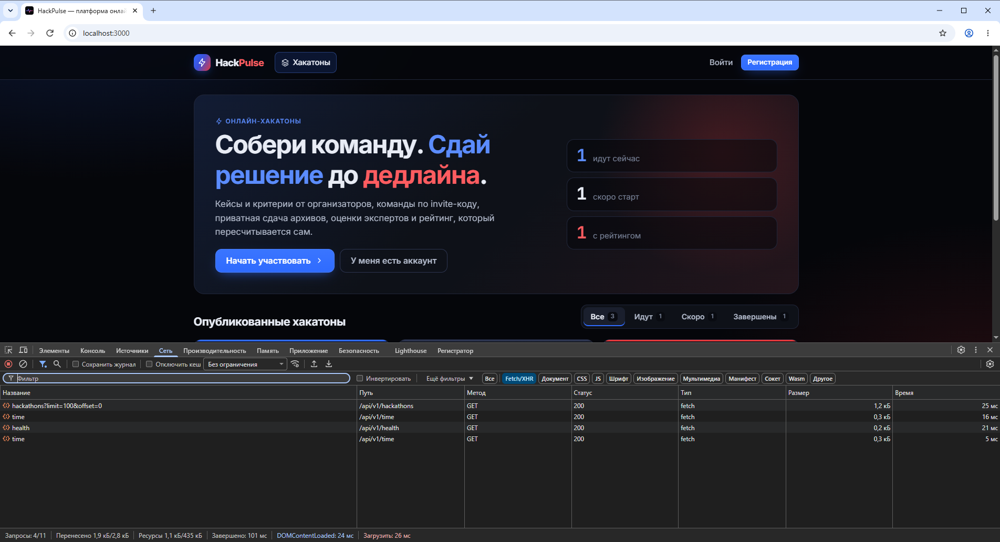
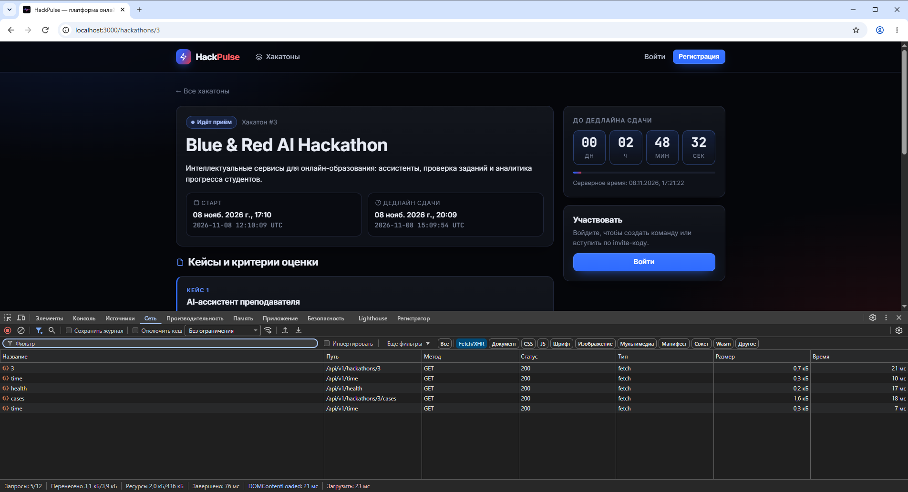
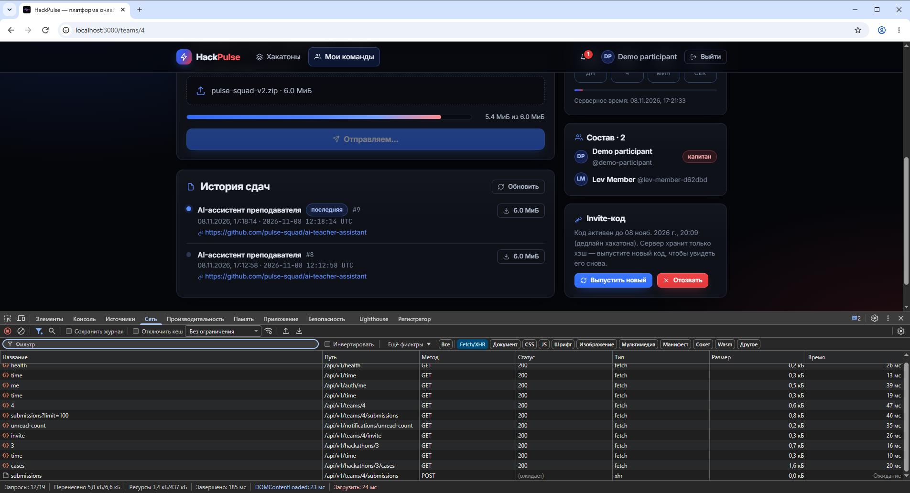
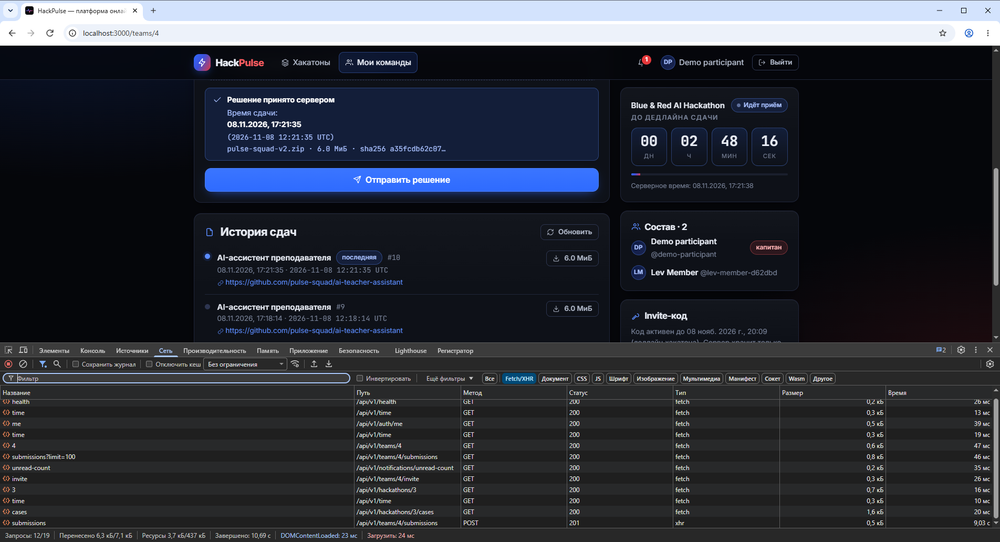
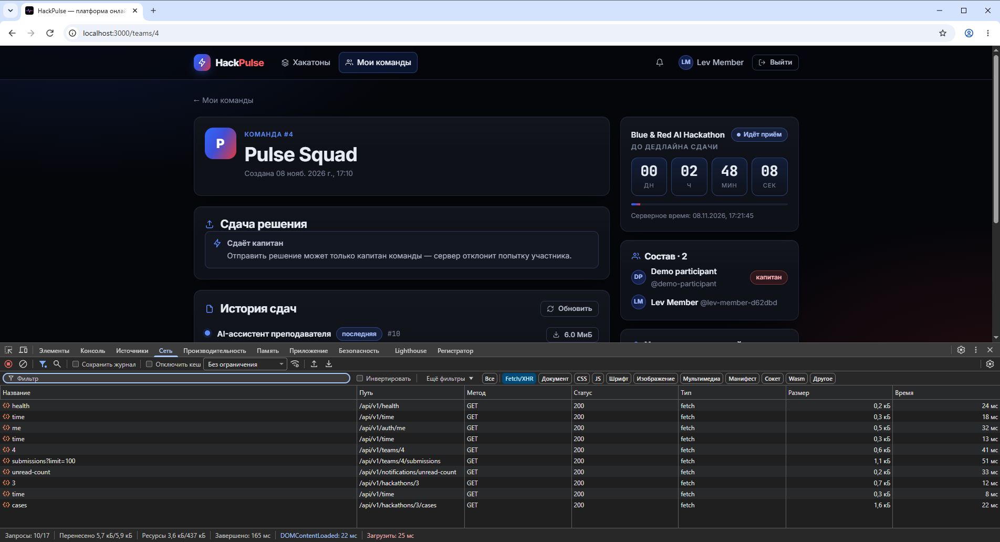
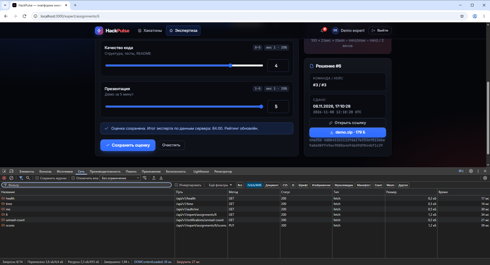
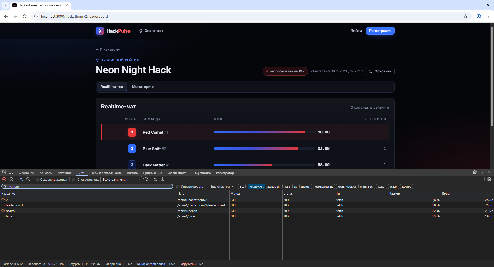
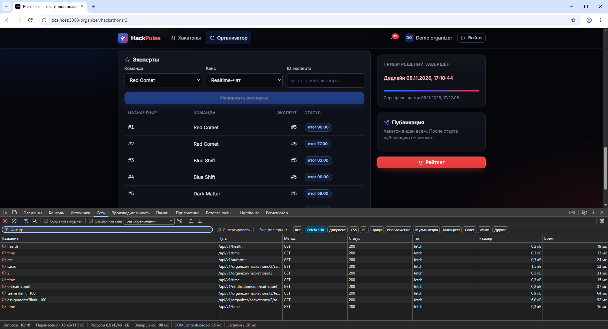
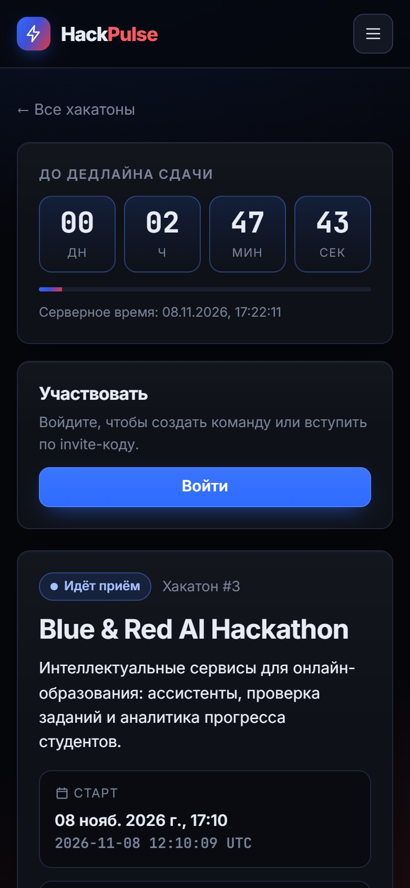

# Мини-отчёт: клиентская часть

Платформа онлайн-хакатонов и соревнований. Команда № 3, группа ПИ41Б.
Оформленные версии отчёта: [DOCX](mini-report-frontend.docx), [PDF](mini-report-frontend.pdf).
Презентация для защиты: [PDF](presentation-frontend.pdf), [PPTX с заметками](presentation-frontend.pptx).

## 1. Ссылка на GitHub

Исходный код фронтенда: https://github.com/Andrey787878/hackhaton/tree/frontend/frontend
(ветка `frontend`, каталог `frontend/`). Описание, запуск и требования ТЗ: [FRONTEND.md](FRONTEND.md).

## 2. Выбранный стек технологий

- **React 18 + TypeScript 5**: компонентный UI, типы DTO повторяют схемы Pydantic бэкенда.
- **React Router 7**: маршруты и защита разделов по ролям.
- **Vite 8**: dev-сервер с HMR и прокси `/api` → FastAPI, production-сборка.
- **CSS с дизайн-токенами**: собственная тема из оттенков чёрного, синего и красного,
  адаптивная вёрстка; шрифты Inter и JetBrains Mono подключены локально через @fontsource.
- **HTTP-клиент на `fetch`**: Bearer-токен, единый refresh при 401 с блокировкой между
  вкладками, перевод ошибок FastAPI; `XMLHttpRequest` для загрузки с прогрессом.
- **Vitest**: 16 unit-тестов: формула оценки, серверные часы, разбор ошибок, валидация.
- **nginx в Docker**: раздача сборки и прокси `/api` на контейнер API, сервис `web` в Compose.

## 3. Структура проекта

```text
frontend/
├── Dockerfile               # сборка (Node.js) → раздача (nginx)
├── nginx.conf               # SPA fallback, прокси /api → api:8080, лимит тела 21 МиБ
├── vite.config.ts           # dev-прокси /api, настройки Vitest
└── src/
    ├── main.tsx             # точка входа: роутер, AuthProvider, стили
    ├── App.tsx              # карта маршрутов и защита по ролям
    ├── api/                 # сервисы работы с REST API
    │   ├── client.ts        # fetch, Bearer, refresh rotation, ошибки, upload с прогрессом, download
    │   ├── errors.ts        # ApiError и перевод ответов FastAPI/Pydantic
    │   ├── types.ts         # типы DTO бэкенда
    │   ├── auth.ts          # вход, регистрация, профиль, сессии
    │   ├── hackathons.ts    # публичные хакатоны, кейсы, рейтинг; кабинет организатора
    │   ├── teams.ts         # команды, invite-коды, сдачи, архивы
    │   ├── scoring.ts       # назначения экспертов и оценки
    │   └── notifications.ts # журнал уведомлений
    ├── auth/                # AuthContext, RequireAuth, хранение пары JWT
    ├── hooks/               # useAsync, useInterval, useServerNow
    ├── components/          # Layout, Countdown, CriteriaTable, Badges, Feedback, Icon
    ├── pages/               # HomePage, HackathonPage, LeaderboardPage, AuthPages, TeamsPage,
    │                        # TeamPage, ExpertPages, OrganizerPage, OrganizerHackathonPage,
    │                        # NotificationsPage, ProfilePage
    ├── utils/               # даты, формула оценки, серверные часы, валидация, роли, тесты
    └── styles/              # tokens.css (палитра), base.css, components.css, pages.css
```

Страницы получают данные только через сервисы `api/*.ts`, а права проверяет сервер.
Таймер `Countdown` считает время по смещению часов устройства относительно
`GET /api/v1/time` (FE-01). Для страницы итогов добавлен публичный маршрут
`GET /api/v1/hackathons/{id}/leaderboard`, для него написан интеграционный тест.

## 4. Скриншоты

Сняты в Google Chrome с открытой вкладкой DevTools «Сеть» (фильтр Fetch/XHR).
Видны запросы к `/api/v1` с методами и успешными ответами 200/201. Стенд запущен
в Docker Compose: `web` (nginx), `api`, PostgreSQL, MinIO.

| | |
|---|---|
|  **1.** Каталог хакатонов |  **2.** Хакатон и таймер по серверному времени (FE-01) |
|  **3.** Загрузка архива с прогрессом, POST в процессе (FE-03) |  **4.** Решение принято: POST 201, серверное время сдачи (FE-03) |
|  **5.** Участник без прав капитана: нет управления (FE-02) |  **6.** Оценка эксперта: PUT 200, итог от сервера (FE-04) |
|  **7.** Публичный рейтинг с автообновлением (FE-05) |  **8.** Кабинет организатора: назначения экспертов |

 **9.** Мобильная вёрстка (390 px)

Воспроизведение: `docker compose up --build -d --wait`, затем `seed-demo` (см. [DEMO.md](DEMO.md))
и `python3 scripts/seed_ui_demo.py`. Интерфейс откроется по адресу http://localhost:3000.
